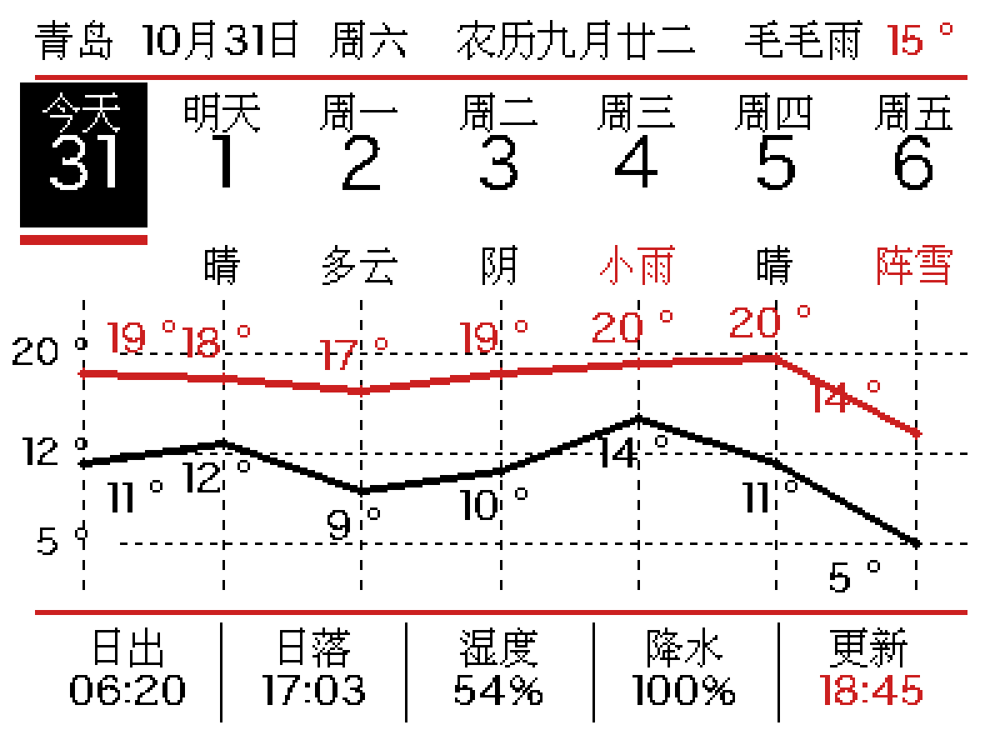

# ESP32-S3 三色墨水屏周视图看板

基于 **ESP32-S3** + **4.2 寸黑白红三色墨水屏（400×300, SSD1683）** 的桌面信息看板：七日滚动日历、逐日天气、双温度折线、农历、日出日落 / 湿度 / 降水概率，一屏尽收。



> 预览图与屏幕显示**逐像素一致**（预览与设备端共用同一份版式代码和字库，上屏前做无头比对）。

## 功能

- **七日滚动日历**：今天黑块白字高亮 + 红色下划条，含农历（1900–2100 全量，支持闰月）
- **逐日天气词**：雨 / 雪 / 雷天气自动红字提醒（今日列留空，头部已有当前天气）
- **双温度折线**：红色 = 每日最高温，黑色 = 每日最低温，左侧共享刻度
- **底部五项指标**：日出 / 日落 / 湿度 / 今日降水概率 / 更新时间
- **数据源**：NTP 对时（多服务器自动切换）+ open-meteo 七天预报（免费、纯 HTTP 免密钥）
- **断网兜底**：取数失败自动使用本地缓存 `wcache2.json`
- **开机自启 + 失败自恢复**：`main.py` 导入主程序，异常时保留屏上画面 60 秒后自动重启
- **刷新节奏**：默认 3 小时一次（`REFRESH_MIN` 可调），跨天强制刷新；三色屏建议全刷间隔 ≥180s

## 硬件

| 部件 | 型号/规格 |
|---|---|
| 主控 | ESP32-S3 (N16R8, 8MB Flash + PSRAM) |
| 屏幕 | 4.2inch e-Paper (B), 400×300, 黑白红三色, 驱动 IC: SSD1683 |
| 固件 | MicroPython v1.19.1 (ESP32_GENERIC_S3) |

### 接线（SPI）

| 墨水屏驱动板 | ESP32-S3 GPIO |
|---|---|
| BUSY | 7 |
| RST | 8 |
| DC | 9 |
| CS | 10 |
| MOSI | 11 |
| SCK | 12 |

原理图见 [`docs/ESP32-S3-SCH.pdf`](docs/ESP32-S3-SCH.pdf)。

## 快速开始

1. **刷固件**：将 MicroPython 固件（本机用的是 `v1.19.1`）烧录到 ESP32-S3：
   ```bash
   esptool.py --port /dev/cu.usbmodemXXXX erase_flash
   esptool.py --port /dev/cu.usbmodemXXXX write_flash 0x0 <firmware>.bin
   ```
2. **配置私有参数**：复制 `micropython/secrets.example.py` 为 `micropython/secrets.py`，填入 WiFi、城市、经纬度（`secrets.py` 已被 `.gitignore` 排除，不会提交）
3. **（可选）本地生成设备脚本**：已生成的 `epd_week_board.py` 可直接用；想改版式则重新生成（见下节），本机需要 Python3 + Pillow
4. **上传到设备**（用 [mpremote](https://docs.micropython.org/en/latest/reference/mpremote.html)）：
   ```bash
   mpremote connect /dev/cu.usbmodemXXXX fs cp epd_week_board.py :
   mpremote connect /dev/cu.usbmodemXXXX fs cp secrets.py :
   mpremote connect /dev/cu.usbmodemXXXX fs cp main.py :
   mpremote connect /dev/cu.usbmodemXXXX reset
   ```
5. 通电即运行：自动连 WiFi → NTP 对时 → 取天气 → 刷屏，之后每 3 小时自动刷新

**电池模式**：把 `gen_week_board.py` 中 `OFFGRID` 改为 `True` 后重新生成上传，每次刷完即进深睡、定时唤醒，平均电流从几十 mA 降到几十 µA。

## 开发流水线（预览先行）

改版式不需要等 20 秒刷屏，全程本地出图：

```
wb_layout.py            版式逻辑（与画布实现无关，设备端/本地预览共用）
        ↓
gen_week_board.py       生成三套位图字库(15/17/30px) + 设备脚本 epd_week_board.py + 3x 预览 PNG
        ↓
test_week_board_headless.py   桩跑设备脚本，与预览逐像素比对(0 差异才上屏)
```

- **改版式**：只动 `wb_layout.py` → 跑 `gen_week_board.py` 看 `week_board_preview.png` → 满意后上传
- **加新文案**：把用到的字加进 `gen_week_board.py` 的 `POOL_S/POOL_M` 字符池（缺字会被静默跳过）
- **换刷新间隔**：`gen_week_board.py` 里 `REFRESH_MIN`（分钟）

### 字库方案（踩坑结论）

- **≤17px 的汉字一律用 HZK16 点阵**（仓库内 `HZK16`，16×16 国标点阵）：矢量字体缩到 13–15px 时，"度/新"的顶点、"湿"的点笔会物理性丢失或粘连，实测 7 种字体/字重/阈值组合均劣于点阵
- 数字 / `°` / `%` 等符号保留 4 倍超采样 + LANCZOS 的矢量渲染（15px 下清晰）
- 30px 大数字用矢量（日历日期），笔画裕量充足

### 三色屏局部刷新实测结论

三色屏（SSD1683）**不支持局部刷新**：向小窗口写数据后用局部刷新指令 `0x22=0xFF`，实测 BUSY 时长 17.4s 与全刷完全相同——OTP 里只烧录了三色全刷波形。因此本项目采用"低频全刷 + 深睡"路线，不做局部刷新优化。详见 [`micropython/experiments/`](micropython/experiments/)。

## 目录结构

```
├── README.md
├── docs/
│   ├── ESP32-S3-SCH.pdf          # 开发板原理图
│   └── ref/GxEPD2_EPD.h          # GxEPD2 驱动参考(佐证三色屏无局部刷新)
├── micropython/
│   ├── main.py                   # 设备入口: 导入主程序, 失败自恢复
│   ├── epd_week_board.py         # 设备端脚本(由生成器产出, 含字库)
│   ├── secrets.example.py        # 私有配置模板 → 复制为 secrets.py
│   ├── gen_week_board.py         # 构建器: 字库 + 版式 + 数据层 → 设备脚本/预览
│   ├── wb_layout.py              # 版式逻辑(与画布无关)
│   ├── wb_lunar.py               # 农历算法(1900-2100, 已与 lunardate 校验)
│   ├── HZK16                     # 16x16 汉字点阵库
│   ├── week_board_preview.png    # 预览图(与屏幕逐像素一致)
│   ├── test_week_board_headless.py  # 无头逐像素比对
│   ├── preview_alt.py            # 版式方案对比渲染
│   ├── preview_foot5.py          # 底部指标候选渲染
│   └── experiments/              # 硬件实验: 局部刷新/LUT 波形扫描
```

## 设备端文件清单（flash 根目录）

| 文件 | 作用 |
|---|---|
| `boot.py` | 空模板 |
| `main.py` | 入口，导入主程序并自恢复 |
| `epd_week_board.py` | 看板主程序（驱动 + 字库 + 版式 + 数据） |
| `secrets.py` | WiFi/城市配置（私有） |
| `wcache2.json` | 天气缓存（运行时自动生成） |

## 已知限制与后续方向

- 三色屏无灰阶、无局部刷新，不适合动画/秒级内容（详见上文实测结论）
- 每分钟一刷的理论寿命约 2 年，当前 3 小时一刷可大幅延长
- 可扩展方向：EC11 旋转编码器做待办勾选、BME280 室内外温湿度对比、三色抖动照片框
