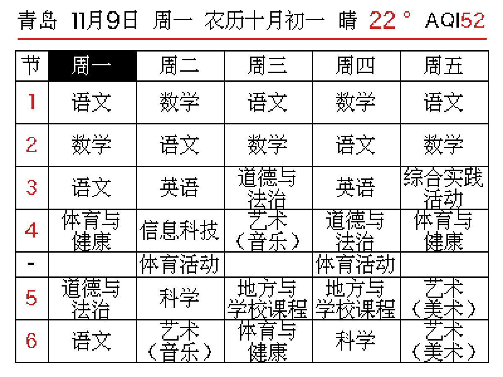

# ESP32-S3 三色墨水屏信息看板

基于 **ESP32-S3 (N16R8)** + **4.2 寸黑白红三色墨水屏（400×300，SSD1683）** 的桌面看板。仓库内含三个可切换的应用：**课表（当前默认）**、周视图看板、信息时钟；三者共用同一套硬件驱动、农历算法与位图字库方案。



> 预览图与设备画面**逐像素一致**：版式代码和字库在本地与设备端共用，上屏前用无头测试逐像素比对（`mismatch: 0 / 120000` 才通过）。

---

## 一、应用一览

| 应用 | 设备脚本 | 主要内容 | 刷新节奏 | 数据源 | 预览 |
|---|---|---|---|---|---|
| **课表（默认）** | `week_class_list.py` | 周看板同款头部 + 全框线课表；节次红数字、今日列黑底白字、午休行 `-`、AQI 数值红色 | 启动 / 7·12·17 点 / 跨天 / 天气显著变化，约 5 次·天 | open-meteo 实时天气 + AQI | [课表预览](micropython/week_class_preview.png) |
| 周视图看板 | `epd_week_board.py` | 七日滚动日历、逐日天气词、双温度折线、农历、底部指标 | 每 180 分钟（`REFRESH_MIN`）；可切深睡电池模式 | open-meteo 七天预报 | [周看板预览](micropython/week_board_preview.png) |
| 信息时钟 | `epd_info_clock.py` | 大字号实时时钟、星期、农历·节气、湿度 / 日出日落 / 可选 AQI | 每分钟（`CLOCK_STEP_MIN`） | wttr.in j1 流式解析 | [信息时钟预览](micropython/info_clock_preview.png) |

切换方式见「快速开始」第 5 步。默认应用由设备根目录 `main.py` 的 import 决定。

---

## 二、硬件与接线

| 部件 | 型号 / 规格 |
|---|---|
| 主控 | ESP32-S3 N16R8（8MB Flash + PSRAM） |
| 屏幕 | 4.2inch e-Paper (B)，400×300，黑白红三色，驱动 IC SSD1683 |
| 固件 | MicroPython（本机实测 v1.19.1 `GENERIC_S3-20220618`；另有 v1.27~v1.29 SPIRAM_OCT 试验固件） |
| 通信 | SoftSPI 2MHz，polarity=0 / phase=0 |

| 驱动板引脚 | ESP32-S3 GPIO |
|---|---|
| BUSY | 7 |
| RST | 8 |
| DC | 9 |
| CS | 10 |
| MOSI | 11 |
| SCK | 12 |
| MISO | 6 |

原理图见 [`docs/ESP32-S3-SCH.pdf`](docs/ESP32-S3-SCH.pdf)，驱动参考见 [`docs/ref/GxEPD2_EPD.h`](docs/ref/GxEPD2_EPD.h)。

---

## 三、快速开始

以下命令在仓库 `micropython/` 目录执行；本机为 Windows + `COM3`，Linux / macOS 把端口换成 `/dev/ttyUSB0`、`/dev/cu.usbmodemXXXX` 等。

1. **准备工具**（本地构建与设备操作）：
   ```bash
   pip install pillow pyserial mpremote esptool
   ```
   本地生成还需要一个中文字体：Windows 用 `msyh.ttc` / `msyhbd.ttc`（或 `simhei.ttf`），macOS 回退到 `Hiragino Sans GB.ttc`；生成器会自动挑选。

2. **刷 MicroPython 固件**（已烧录可跳过）：
   ```bash
   esptool.py --port COM3 erase_flash
   esptool.py --port COM3 write_flash 0x0 GENERIC_S3-20220618-v1.19.1.bin
   ```

3. **配置私有参数**：复制 `secrets.example.py` → `secrets.py`，填入 WiFi、城市、经纬度、时区。`secrets.py` 已被 `.gitignore` 排除，**不会入库**。
   ```python
   SSID = "YourWiFiSSID"
   PWD = "YourWiFiPassword"
   CITY = "青岛"          # 头部城市名 / wttr.in 查询名（需包含在字库字符池内）
   LAT = "36.07"
   LON = "120.38"
   TZ = 8 * 3600
   ```

4. **上传并启动**（默认课表）：
   ```bash
   mpremote connect COM3 fs cp secrets.py :secrets.py
   mpremote connect COM3 fs cp main.py :main.py
   mpremote connect COM3 fs cp week_class_list.py :week_class_list.py
   mpremote connect COM3 fs cp class_data.json :class_data.json
   mpremote connect COM3 reset
   ```
   启动流程：连 WiFi → NTP 对时（`cn.pool.ntp.org` 优先）→ 取天气 / AQI → 刷屏。首次刷屏约 15 秒。

5. **查看启动日志**（可选）：
   ```bash
   python tools/boot_capture.py COM3 38
   ```
   正常应看到：
   ```
   MPY: soft reboot
   [boot] class list start
   [class] json ok: class_data.json rows=6 cols=5
   [wifi] ok
   [ntp] ok via cn.pool.ntp.org
   [aqi] ok 52
   [wx] ok
   ```
   USB 连上后也可按 `Ctrl-C` 进入 REPL、`Ctrl-D` 软复位。

6. **切换到其他应用**：把 `main.py` 中的 `import week_class_list` 改为 `import epd_week_board` 或 `import epd_info_clock`，重传 `main.py` 并复位即可（对应的设备脚本也需上传）。

**电池模式（仅周看板）**：把 `gen_week_board.py` 的 `OFFGRID` 改为 `True` 后重新生成上传，每次刷完进入深睡、定时唤醒，平均电流从几十 mA 降到几十 µA。

---

## 四、课表数据外置：`class_data.json`

课表内容**不在代码里**，而是设备根目录的 `class_data.json`（本地副本 `micropython/class_data.json`）。本地与设备两份内容应保持一致。

| 字段 | 说明 |
|---|---|
| `rows` | 6 行 × 5 列正课；单元格写字符串＝单行，写 `["上半", "下半"]`＝两行折行 |
| `weekdays` | 表头星期名，列数随它变化（5 列时列宽 70px，7 列自动变 50px） |
| `periods` | 节次列标签，缺省为 `1..N` |
| `break` | 午休行内容（null / 空串表示该列无内容） |
| `break_after` | 午休行插在第几节之后，默认 `4`（即第 4 节后） |
| `break_label` | 午休行节次标签，默认 `-`（与原课表一致） |

**改课表只需两步**：编辑 `class_data.json` → 上传到设备根目录。设备每次刷屏都会重读该文件，**不用重启、不用重传主程序**；节数 / 列数变化时行高、列宽自动均分，表格底始终对齐 288px。

> ⚠️ 字库是生成时固化的位图。若课表里出现**全新汉字**，必须：同步修改本地 `class_data.json` → 重跑 `gen_week_class.py`（生成器按 JSON 自动补齐字符池）→ 重传 `week_class_list.py`。仅调换已有课程名则不需要。设备启动会打印 `[class] missing glyphs: ...` 提示缺字。

三级兜底：**外置 JSON → 生成时注入设备脚本的 JSON 快照 → 全 `-` 占位课表**。文件缺失或 JSON 损坏都不会黑屏。

AQI 来自 `air-quality-api.open-meteo.com`（独立域名，不是 `api.open-meteo.com`），缓存在 `wcache2.json`；无数据时头部自动隐藏该段。标签 `AQI` 为黑色，数值为红色。

---

## 五、刷新策略与屏幕特性

| 应用 | 关键配置 | 策略 |
|---|---|---|
| 课表 | `REFRESH_HOURS=(7,12,17)`、`CHECK_MIN=60`、`TEMP_DELTA=3` | 启动必刷、固定时刻刷、跨天刷；温差 ≥3°C 或天气现象变化补刷。轮询只取数不刷屏，约 5 次/天（旧 24 次/天，降约 79%） |
| 周看板 | `REFRESH_MIN=180`、`OFFGRID=False` | 定时全刷 + 跨天强制刷；`OFFGRID=True` 时改为深睡唤醒 |
| 信息时钟 | `CLOCK_STEP_MIN=1`、`WEATHER_MIN=30`、`NTP_MIN=180` | 分钟级变化触发全刷；改 `CLOCK_STEP_MIN=5` 可降为 5 分钟一闪 |

- **规律闪烁是物理特性**：三色屏全刷指令 `0x22=0xF7` 会黑白红交替闪约 15 秒，不是故障。降低全刷次数是唯一有效手段。
- **不支持局部刷新**：实测向小窗口写数据后用 `0x22=0xFF`，BUSY 时长 17.4s 与全刷相同——OTP 只烧录了三色全刷波形。详见 [`micropython/experiments/`](micropython/experiments/)。
- 刷屏后发送 `0x07/0x03` 进入深度休眠；取数失败有错误退避，避免反复重试。
- 设备取数失败会退回本地缓存；`wcache2.json` 由课表与周看板共用，周看板覆盖缓存后其中的 `aqi` 字段会丢失，此时课表断网会自动隐藏 AQI（不报错）。信息时钟使用 `/wcache.json`。

---

## 六、开发流水线（预览先行）

改版式不必等 15 秒刷屏，全程本地出图：

```
版式源  wb_layout.py / wb_class_layout.py / class_data.json
   ↓  生成器读取字库 HZK16 + 公共农历 wb_lunar.py + 字符池
构建器  gen_week_board.py / gen_week_class.py / gen_info_clock.py
   ↓  产出：设备脚本(含字库) + 3x 预览 PNG
验证    tests/  桩跑设备脚本，逐像素比对 / 端到端渲染 / 策略仿真
   ↓
部署    mpremote fs cp → 设备根目录 → reset
```

| 构建命令 | 产出 |
|---|---|
| `python gen_week_class.py` | `week_class_list.py` + `week_class_preview.png`（按 `class_data.json` 动态构建字库） |
| `python gen_week_board.py` | `epd_week_board.py` + `week_board_preview.png` |
| `python gen_info_clock.py` | `epd_info_clock.py` + `info_clock_preview.png`（用 `tests/fixtures/wttr_qd.json` 作天气样本） |

> **目录约束**：三个生成器都以 `HERE = os.path.dirname(__file__)` 定位 `HZK16`、`wb_lunar.py`、版式源与数据文件，因此 `micropython/` 下的这些文件必须保持在**同一层**，不要拆进子目录；`tests/`、`tools/`、`experiments/` 是独立的可移动目录。

### 字库方案（踩坑结论）

- **≤17px 的汉字一律用 HZK16 点阵**（仓库内 `HZK16`，16×16 GB2312 点阵）：矢量字体缩到 13–15px 时"度 / 新"的顶点、"湿"的点笔会物理性丢失或粘连，实测 7 种字体 / 字重 / 阈值组合均劣于点阵。
- 数字、`°`、`%` 等符号用 4 倍超采样 + LANCZOS 矢量渲染；30px 大数字（信息时钟、日历日期）也用矢量。
- 字模格式 `bytes([宽, 高, dy]) + 逐行打包位图`（位 1 = 墨迹，MSB 优先）。`dy` 按**墨迹中心**对齐到 HZK16 中心 7.5px，解决"一"、"廿一"顶对齐与数字下沉问题；阈值 `THRESH=170`，勿反向。
- 信息时钟为早期实现，字模是 `bytes([宽, 高]) + 数据` 的两字节头，改动时注意区分。

---

## 七、测试与工具

全部在 `micropython/` 目录执行，只需 CPython + Pillow（设备工具另需 pyserial）：

| 命令 | 作用 | 通过标志 |
|---|---|---|
| `python tests/test_week_board_headless.py` | 周看板设备画布 vs 预览逐像素比对 | `mismatch: 0 / 120000` |
| `python tests/test_sim.py` | 信息时钟端到端：桩跑设备脚本 + 流式天气解析 + 渲染 `info_clock_sim.png` | `SIM OK` |
| `python tests/sim_class.py` | 课表端到端：外置 JSON、几何、缺字、热重载、AQI 配色逐像素断言、渲染 `week_class_sim.png` | `AQI color: OK` |
| `python tests/test_class_data.py` | 课表数据六组单测：解析 / 几何自适应 / 非法拒绝 / 三级兜底 / 热重载 / 缺字 | `ALL PASS` |
| `python tests/test_refresh.py` | 虚拟时钟验证课表刷新策略（24h 全刷次数） | `刷新策略验证: PASS` |
| `python tools/boot_capture.py COM3 38` | 中断主循环 → 软复位 → 捕获 38 秒启动日志 | 见第三节日志样例 |

`*_sim.png` 与 `layout_*.png` 为测试 / 版式候选产物，已由 `.gitignore` 排除；`*_preview.png` 入库作为文档配图。

---

## 八、目录结构

```
esp32-s3-n16r8/
├── README.md                     # 本文档
├── .gitignore                    # 私有配置 / 归档 / 产物忽略规则
├── docs/
│   ├── ESP32-S3-SCH.pdf          # 开发板原理图
│   └── ref/GxEPD2_EPD.h          # 驱动参考(三色屏无局部刷新的佐证)
├── micropython/
│   ├── main.py                   # 设备入口(默认课表), 异常自恢复
│   ├── secrets.example.py        # 私有配置模板 → 复制为 secrets.py(不入库)
│   ├── class_data.json           # 课表数据(外置, 单独上传即可改课表)
│   ├── HZK16                     # 16×16 GB2312 汉字点阵库
│   ├── wb_lunar.py               # 公共农历/节气算法(1900-2100, 已与 lunardate 校验)
│   │
│   │   ── 应用 A: 课表(默认) ──
│   ├── wb_class_layout.py        #   版式 + 外置数据加载(设备/预览共用)
│   ├── gen_week_class.py         #   构建器: 动态字库 + 版式 + 数据层 → 设备脚本/预览
│   ├── week_class_list.py        #   设备脚本(生成物, 含字库与 JSON 快照兜底)
│   ├── week_class_preview.png    #   预览图
│   │
│   │   ── 应用 B: 周视图看板 ──
│   ├── wb_layout.py              #   版式(设备/预览共用)
│   ├── gen_week_board.py         #   构建器
│   ├── epd_week_board.py         #   设备脚本(生成物)
│   ├── week_board_preview.png    #   预览图
│   ├── preview_alt.py            #   版式方案对比渲染
│   ├── preview_foot5.py          #   底部指标候选渲染
│   │
│   │   ── 应用 C: 信息时钟 ──
│   ├── gen_info_clock.py         #   构建器
│   ├── epd_info_clock.py         #   设备脚本(生成物)
│   ├── info_clock_preview.png    #   预览图
│   │
│   ├── tests/                    # 本地无头验证(不接硬件)
│   │   ├── test_week_board_headless.py
│   │   ├── test_sim.py / sim_class.py
│   │   ├── test_class_data.py / test_refresh.py
│   │   └── fixtures/wttr_qd.json    # 天气解析真实样本
│   ├── tools/boot_capture.py     # 串口启动日志捕获
│   └── experiments/              # 硬件实验: 局部刷新 / LUT 波形扫描
└── _local/                       # 本地归档(被 .gitignore 排除, 见第十节)
```

### 设备端文件清单（flash 根目录）

| 文件 | 作用 |
|---|---|
| `boot.py` | 空模板 |
| `main.py` | 入口，导入主程序并在异常时自恢复 |
| `week_class_list.py` | 课表主程序（驱动 + 字库 + 版式 + 数据） |
| `class_data.json` | 课表数据（外置，改内容只覆盖这个文件） |
| `epd_week_board.py` | 周看板主程序（可选） |
| `epd_info_clock.py` | 信息时钟主程序（可选） |
| `secrets.py` | WiFi / 城市 / 经纬度（私有，不入库） |
| `wcache2.json` | 课表 + 周看板共用天气 / AQI 缓存（运行时生成） |
| `wcache.json` | 信息时钟天气缓存（运行时生成） |

---

## 九、已知限制与后续方向

- 三色屏**无灰阶、无局部刷新**，不适合动画或秒级内容；每次全刷约 15 秒并伴随闪烁。
- 信息时钟默认每分钟一刷，闪烁最明显；可调 `CLOCK_STEP_MIN`，或改用课表 / 周看板的低频策略。
- 课表 AQI 依赖共用缓存 `wcache2.json`，周看板重写缓存后该字段可能丢失（断网时自动隐藏）。
- 位图字库只覆盖生成时字符池中的字符：新增文案 / 课程名若含新汉字，必须重跑对应生成器。
- HZK16 为 GB2312 点阵，生僻字需改用矢量渲染并调整字号与阈值。
- 设备端全部走 HTTP（免密钥）：`open-meteo`、`air-quality-api.open-meteo.com`、`wttr.in`；若网络阻断 HTTPS，这正是选 HTTP 的原因。
- 可扩展方向：EC11 旋转编码器做待办勾选、BME280 室内外温湿度对比、三色抖动照片框。

---

## 十、仓库整理说明

历史调试产物已按类别**移动、未删除**到 `_local/`（该目录被 `.gitignore` 排除，不会提交）：

| 归档目录 | 内容 |
|---|---|
| `_local/firmware/` | MicroPython 固件 `.bin`、flash dump |
| `_local/logs/` | 串口日志、烧录日志、monitor / scan 文本、农历表草稿 |
| `_local/debug/` | 一次性硬件探测、农历对拍脚本、`lunardate` 校验库、废弃裁切预览图 |
| `_local/legacy/` | 早期"中科芯云"启动画面生成器与产物 |
| `_local/demo/` | 开发板出厂示例 |
| `_local/ref/`、`_local/dup/` | 旧版驱动头文件、与 `docs/` 重复的原理图 / 日志副本 |
| `_local/verify/` | 设备文件回读副本，用于校验本地生成物与设备是否一致 |

同一批整理中修掉的隐患：

- 信息时钟曾把 WiFi 凭据硬编码在 `gen_info_clock.py` / `epd_info_clock.py`，现统一改为 `import secrets`（与其他两个应用一致）；`secrets.py` 不入库。
- `gen_info_clock.py`、`test_sim.py`、`sim_class.py`、`test_refresh.py` 曾写死本机绝对路径，现全部改为基于 `__file__` 的相对定位，仓库可任意搬迁 / 克隆。
- 三个生成器与版式候选脚本的字体路径改为跨平台自动挑选。
- 测试脚本不再依赖本机私有 `secrets.py` 或当前工作目录，改用显式桩模块。
- `.gitignore` 统一忽略固件、日志、仿真图与版式候选图；`.git/info/exclude` 的本地临时规则已收敛。

如需取回任一归档文件，直接从 `_local/` 对应子目录移回即可；其中标注为重复 / 废弃的文件不建议恢复。

---

## 十一、常见问题

| 现象 | 原因与处理 |
|---|---|
| 屏幕规律地每分钟闪一次、约 15 秒 | 三色全刷物理特性，非故障。改 `CLOCK_STEP_MIN`（信息时钟）或 `REFRESH_HOURS` / `REFRESH_MIN`（另两个应用） |
| 某个汉字缺笔画、数字明显下沉 | 字库阈值 / 基线对齐问题，重跑对应生成器；勿手工改生成物 |
| 启动日志出现 `[class] missing glyphs: ...` | 课表含新汉字，按第四节流程重跑 `gen_week_class.py` 并重传脚本 |
| 改了 `class_data.json` 但屏幕没变 | 下一次刷新才生效（课表约 7/12/17 点或天气变化）；也可复位设备立即刷新 |
| 上传文件后仍跑旧逻辑 | 需软复位：`Ctrl-C` → `Ctrl-D`，或 `mpremote connect COM3 reset` |
| NTP / 天气超时、屏幕显示旧数据 | 已配置国内 NTP 优先与本地缓存兜底；检查 WiFi 与 HTTP 出网 |
| 设备内存不足（OOM） | 信息时钟对 wttr.in 采用流式解析，勿改成整包 `json.loads`；避免在设备端构造大 `bytes` |
